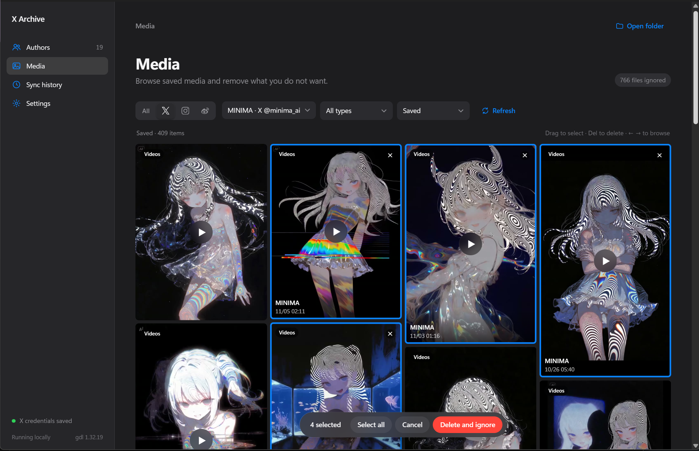

# Media Archive

Media Archive 是 Windows 本地媒体归档工具，用于按账号保存你有权访问的 X、Instagram 和微博图片与视频。支持中文、English、增量同步和媒体画廊。

Media Archive is a Windows desktop app for archiving accessible images and videos from X, Instagram, and Weibo accounts. It supports Chinese and English, incremental sync, and a visual gallery.



## 下载与使用 / Download and use

1. 从 [Releases](https://github.com/AMtanks/Media-Archive/releases) 下载 Windows ZIP，完整解压后运行 `MediaArchive.exe`。Windows 10/11 需要 Microsoft Edge WebView2 Runtime。
2. 在设置中选择中文或 English，并分别登录需要使用的平台。微博登录后保持登录窗口打开，切回应用点击“已在窗口中登录”。
3. 在“添加推主”中输入 X 账号或平台主页链接。微博使用 `https://weibo.com/u/数字ID` 格式。
4. 首次同步扫描历史内容；应用运行时，后续按设置周期增量检查。关闭窗口会收进系统托盘，退出托盘程序或电脑休眠时暂停。

Download the Windows ZIP from [Releases](https://github.com/AMtanks/Media-Archive/releases), extract the entire archive, and run `MediaArchive.exe`. Sign in to the desired platforms in Settings, then add account profile URLs. For Weibo, keep its login window open after signing in and select **I have signed in**. Sync runs while the application is open or in the system tray.

## 功能 / Features

- X、Instagram 帖子和 Reels、微博主页帖子中的可访问媒体；单条多图和视频均可保存。Stories、微博独立相册等内容尚未覆盖。
- 下载平台提供的原图或较高质量视频；平台可能只提供经过处理的版本，也可能限制历史结果或登录访问。无法保证完整历史和上传原文件。
- 按 UTC 发文时间、帖子 ID 和序号命名；同一账号的本地目录首次绑定后保持固定。
- 支持并发下载、定期增量同步、失败重试、账号和平台筛选、媒体预览及批量选择。
- 应用内删除或在 Windows 中删除已记录文件后，后续同步会忽略这些项目；可在忽略清单中恢复。移出账号时可选择保留文件或永久删除当前账号文件夹。
- 登录凭证使用 Windows DPAPI 在本机加密保存。应用记录和媒体保存在 EXE 同目录的 `data` 和 `downloads`；发行包不包含登录凭证、个人下载文件或数据库。
- 如视频处理需要 FFmpeg 且系统未安装，应用会尝试首次下载；FFmpeg 不包含在发行包中。

Images, videos, and multi-image posts are supported where available. The app requests original-size images and high-quality available video, but platforms may return processed files or incomplete results. Post timestamps in filenames use UTC. Deleted recorded files are ignored during later syncs until restored from the ignore list.

## 从源码运行 / Run from source

Requires Windows, Python 3.12, and Edge WebView2 Runtime:

```powershell
py -3.12 -m venv .venv
.venv\Scripts\python.exe -m pip install -r requirements-dev.txt
.venv\Scripts\python.exe main.py
```

`build.cmd` creates a portable Windows build in `work/package-dist/MediaArchive`. It requires PyInstaller from `requirements-dev.txt`. Automated tests: `.venv\Scripts\python.exe -m pytest -q`.

## 授权 / License

Source code is licensed under **GPL-2.0-only**; commercial use is permitted under its terms. See [LICENSE](LICENSE) and [THIRD_PARTY_NOTICES.md](THIRD_PARTY_NOTICES.md). Platform names and marks belong to their respective owners. The example screenshot contains third-party media; those works retain their respective owners’ rights.

请尊重内容创作者的权利及各平台的使用规定。 / Respect creators’ rights and platform terms.
